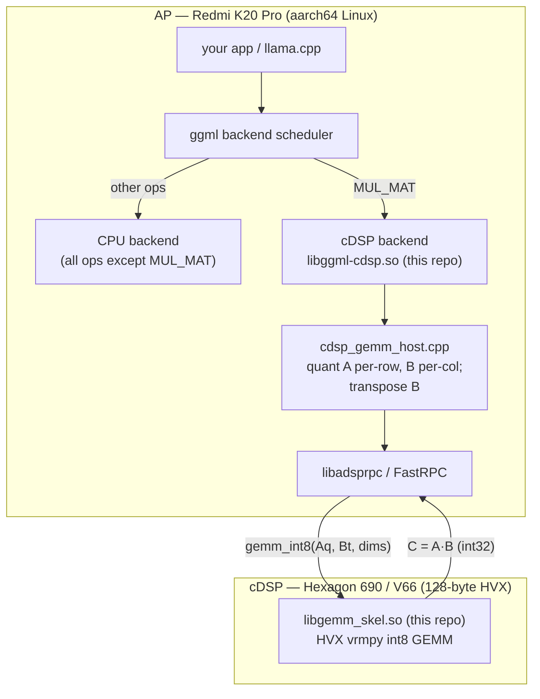
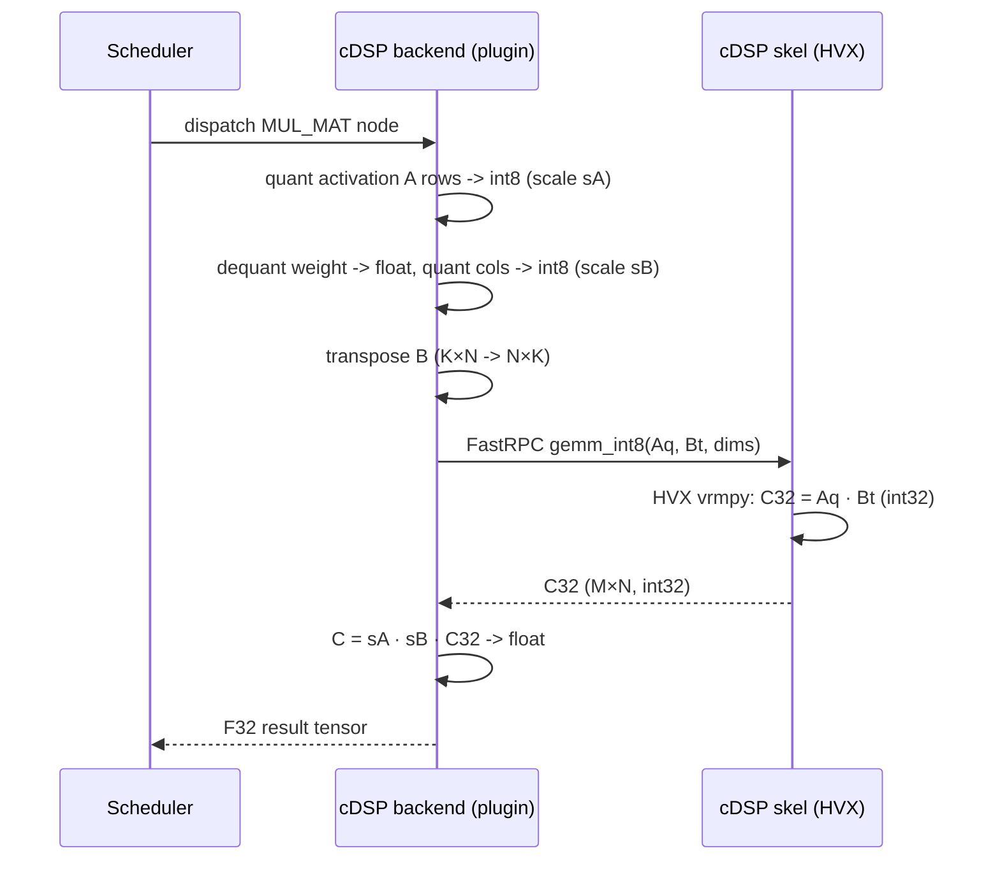
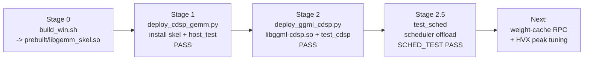

# raphael-cdsp-llm — Run llama.cpp MUL_MAT on the Redmi K20 Pro cDSP (Hexagon 690)

A self-contained, reproducible proof-of-concept that offloads the `MUL_MAT`
(matmul) operator of [llama.cpp](https://github.com/ggml-org/llama.cpp)'s `ggml`
library to the **Redmi K20 Pro (raphael) Hexagon 690 (V66) cDSP**, using a
hand-written FastRPC int8 GEMM kernel accelerated with **HVX** (Hexagon Vector
eXtensions).

> Goal: prove that a custom `ggml` backend can route `MUL_MAT` to the cDSP and
> compute it correctly with `0.0` error vs a CPU int8 emulation, through the real
> `ggml` multi-backend scheduler — the exact integration path llama.cpp uses.

---

## What it does

| Stage | What | Result |
|-------|------|--------|
| 0 | Build the cDSP GEMM skeleton (`libgemm_skel.so`) on Windows with the Hexagon SDK | HVX int8 GEMM kernel |
| 1 | Deploy + run `host_test` on the phone (correctness + timing) | `PASS` at 3 sizes, ~16× faster than scalar |
| 2 | Build the `ggml` backend plugin (`libggml-cdsp.so`) + run `test_cdsp` | `PASS` — cDSP computes `MUL_MAT` correctly |
| 2.5 | Run `test_sched` (scheduler integration) | `SCHED_TEST PASS` — `MUL_MAT→cDSP`, `relu→CPU` |

**Measured results (K20 Pro cDSP, HVX):**

| GEMM size (M×N×K) | Scalar GEMM | HVX GEMM | Speedup |
|---|---|---|---|
| 32×128×128   | 3.12 ms | 0.99 ms  | 3.2× |
| 64×256×256   | 21.97 ms | 2.06 ms  | 10.7× |
| 128×512×512  | 130.84 ms | 7.92 ms | **16.5×** |

Real model-layer dimensions also pass bit-exact
(`host_test 1 4096 4096` → `PASS`, `host_test 1 11008 4096` → `PASS`,
`host_test 32 4096 4096` → `PASS`).

See [docs/next-steps.md](docs/next-steps.md) for the remaining work to make
*end-to-end* llama.cpp inference actually useful (weight-caching + HVX peak tuning).

---

## Architecture



**Per-`MUL_MAT` data flow:**



---

## Reproduction flow



See [docs/reproduce.md](docs/reproduce.md) for the exact commands.

---

## Repository layout

```
raphael-cdsp-llm/
├── README.md                 # this file
├── LICENSE                   # MIT
├── .gitignore
├── .gitattributes            # force LF line endings
├── src/
│   ├── dsp/                  # Stage 0/1: cDSP GEMM kernel sources
│   │   ├── gemm.idl          #   FastRPC IDL (A,B:int8 -> C:int32)
│   │   ├── gemm_dsp.c        #   HVX int8 GEMM implementation
│   │   ├── build_win.sh      #   Hexagon SDK build -> prebuilt/libgemm_skel.so
│   │   └── AEEStdDef.h, AEEStdErr.h
│   ├── host/                 # Stage 1: AP-side correctness + perf test
│   │   └── host_test.c       #   random int8 GEMM -> verify + time
│   ├── ggml-backend/         # Stage 2/2.5: ggml backend plugin
│   │   ├── ggml-cdsp.cpp     #   backend registration + MUL_MAT compute
│   │   ├── cdsp_gemm_host.{h,cpp}  # FastRPC session wrapper
│   │   ├── ggml-backend-impl.h      # ABI pin (copied from ggml 0.9.0)
│   │   ├── build_device.sh   # on-device build -> libggml-cdsp.so
│   │   ├── test_cdsp.cpp     # single-backend correctness test
│   │   └── test_sched.cpp    # scheduler integration test
│   └── gen/                  # QAIC-generated (committed; SDK optional)
│       ├── gemm.h
│       ├── cdsp_gemm_skel.c  #   DSP-side dispatch
│       └── cdsp_gemm_stub.c  #   AP-side marshaling
├── prebuilt/
│   └── libgemm_skel.so       # prebuilt DSP skel (in case you lack the SDK)
├── deps/
│   └── ggml-0.9.0-headers/   # ggml public headers (build dependency)
├── scripts/device/
│   ├── k20_ssh.py            # USB-NCM SSH/SFTP helper (root@172.16.42.1)
│   ├── deploy_cdsp_gemm.py   # Stage 1 deploy + test
│   └── deploy_ggml_cdsp.py   # Stage 2/2.5 deploy + tests
└── docs/
    ├── architecture.md        # detailed architecture + HVX kernel notes
    ├── reproduce.md           # step-by-step reproduction
    └── next-steps.md          # weight-cache RPC + HVX tuning + real inference
```

---

## Prerequisites

**On the device (Redmi K20 Pro / raphael, running Linux on the SoC):**

- The **cDSP FastRPC channel is already enabled**: `cdsprpcd` daemon running,
  unsigned-PD loading allowed (`DSPRPC_CONTROL_UNSIGNED_MODULE`), and skels found
  via `ADSP_LIBRARY_PATH`/`/usr/lib/rfsa/cdsp`.
  This repository *assumes* that channel works. The companion repo
  [`raphael-cdsp-fastrpc`](https://github.com/doeasier/raphael-cdsp-fastrpc)
  documents how to bring it up (firmware swap + daemon drop-in).
- `g++` with C++20, `git`, and the mainline **fastrpc** dev headers
  (`remote.h` under `/usr/local/include/fastrpc`) + `libadsprpc.so`
  (`/usr/local/lib`).
- A build of **llama.cpp 0.9.0** whose `libggml.so` (and `libggml-base.so`,
  `libggml-cpu.so`) is findable on the device.

**On the Windows build host (only for Stage 0):**

- Qualcomm **Hexagon SDK 4.3.0.0** (provides `qaic.exe` + `hexagon-clang.exe`).
  *Optional* — `prebuilt/libgemm_skel.so` is committed, so you can skip Stage 0.

**Network:** phone reachable over USB-NCM at `root@172.16.42.1` (host side
`172.16.42.2`). `scripts/device/k20_ssh.py` holds these defaults; override with
`K20_HOST` / `K20_PORT` / `K20_USER` / `K20_PASS` env vars.

---

## Quick start

```bash
# Clone
git clone https://github.com/doeasier/raphael-cdsp-llm.git
cd raphael-cdsp-llm

# (Optional) Stage 0 — only if you want to rebuild the DSP skel yourself.
# Requires Qualcomm Hexagon SDK 4.3.0.0 on Windows:
cd src/dsp && bash build_win.sh && cd ../..

# Stage 1 — install the skel on the phone and verify the GEMM kernel
python3 scripts/device/deploy_cdsp_gemm.py
#   -> host: PASS - all 4096 elements verified correct.

# Stage 2 + 2.5 — build the ggml backend, run both tests on the phone
python3 scripts/device/deploy_ggml_cdsp.py
#   -> OK: loaded backend 'cdsp'
#   -> PASS
#   -> SCHED_TEST PASS
#   -> "CONFIRMED: scheduler offloaded MUL_MAT to the cDSP backend."
```

That is the whole proof. For the full walkthrough (env setup, expected log
snippets, troubleshooting) see [docs/reproduce.md](docs/reproduce.md).

---

## License

MIT — see [LICENSE](LICENSE). Vendor headers from the Qualcomm Hexagon SDK and
ggml are included only where required to build and are subject to their own
licenses; this project does not redistribute any device firmware binaries.
