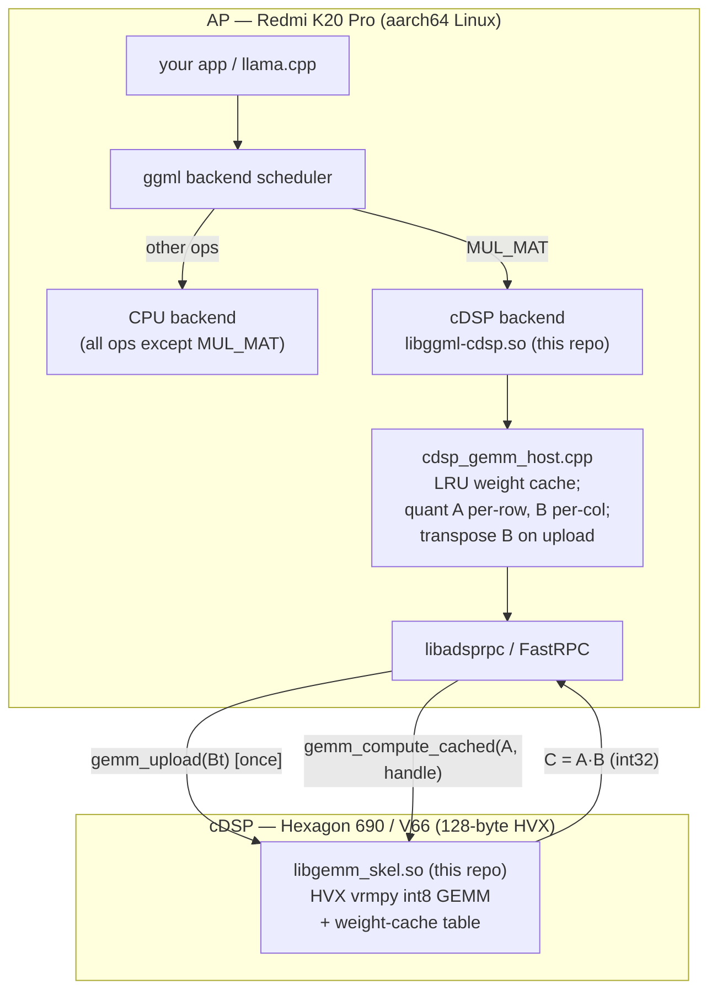
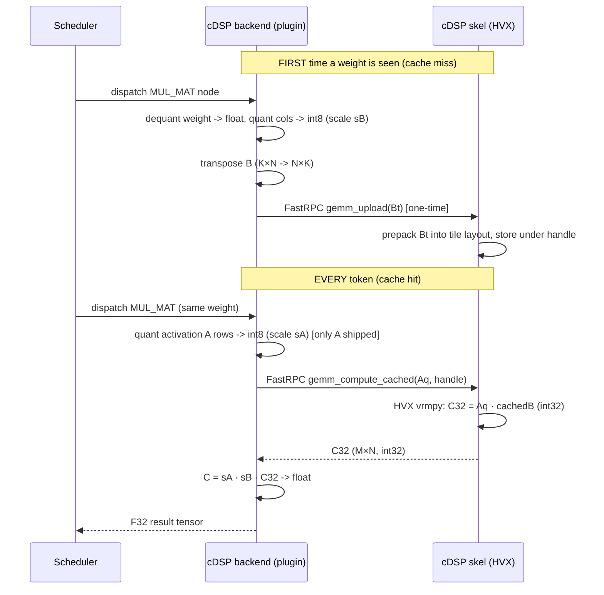
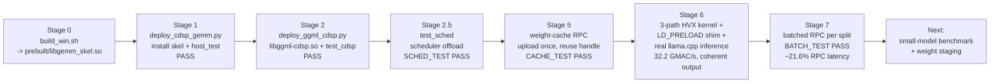

# raphael-cdsp-llm — Run llama.cpp MUL_MAT on the Redmi K20 Pro cDSP (Hexagon 690)

A self-contained, reproducible proof-of-concept that offloads the `MUL_MAT`
(matmul) operator of [llama.cpp](https://github.com/ggml-org/llama.cpp)'s `ggml`
library to the **Redmi K20 Pro (raphael) Hexagon 690 (V66) cDSP**, using a
hand-written FastRPC int8 GEMM kernel accelerated with **HVX** (Hexagon Vector
eXtensions).

> Goal: prove that a custom `ggml` backend can route `MUL_MAT` to the cDSP and
> compute it correctly with `0.0` error vs a CPU int8 emulation, through the real
> `ggml` multi-backend scheduler — the exact integration path llama.cpp uses.

---

## What it does

| Stage | What | Result |
|-------|------|--------|
| 0 | Build the cDSP GEMM skeleton (`libgemm_skel.so`) on Windows with the Hexagon SDK | HVX int8 GEMM kernel |
| 1 | Deploy + run `host_test` on the phone (correctness + timing) | `PASS` at 3 sizes, ~16× faster than scalar |
| 2 | Build the `ggml` backend plugin (`libggml-cdsp.so`) + run `test_cdsp` | `PASS` — cDSP computes `MUL_MAT` correctly |
| 2.5 | Run `test_sched` (scheduler integration) | `SCHED_TEST PASS` — `MUL_MAT→cDSP`, `relu→CPU` |
| 5 | Weight-cache RPC: upload weights once, reuse handle | `test_cache` `CACHE_TEST PASS`; decode 1×11008×4096 drops 762 ms → **37 ms/token** |
| 6 | HVX peak tuning + real llama.cpp inference | 3-path kernel (up to **32.2 GMAC/s**); `Qwen3.5-4B-Q4_K_M` runs end-to-end with coherent output at ~94% of CPU tokens/s |
| 7 | Batched RPC: one FastRPC call per scheduler split | `BATCH_TEST PASS` (1056 elements); **−21.6% RPC latency**, 78–198 round-trips removed per run. End-to-end tokens/s unchanged — see §4.1 |

**Measured results (K20 Pro cDSP, HVX):**

| GEMM size (M×N×K) | Scalar GEMM | HVX GEMM | Speedup |
|---|---|---|---|
| 32×128×128   | 3.12 ms | 0.99 ms  | 3.2× |
| 64×256×256   | 21.97 ms | 2.06 ms  | 10.7× |
| 128×512×512  | 130.84 ms | 7.92 ms | **16.5×** |

**Stage 6 — HVX tuning (`bench_cached`, weight-cache path, warm DSP):**

| Shape | Before | **Stage 6** | Speedup |
|---|---|---|---|
| 1×1024×2560 decode attn | 2.654 ms (1.98 GMAC/s) | **1.743 ms (3.01 GMAC/s)** | 1.5× |
| 1×4096×4096 decode FFN | 14.84 ms (2.26 GMAC/s) | **9.204 ms (3.65 GMAC/s)** | 1.6× |
| 128×512×512 reference | 4.953 ms (13.55 GMAC/s) | **2.188 ms (30.67 GMAC/s)** | 2.3× |
| 32×4096×4096 prompt | 421.2 ms (2.55 GMAC/s) | **94.28 ms (11.39 GMAC/s)** | 4.5× |

Against the original one-shot `gemm_int8` number of 4.2 GMAC/s (prepack in the
hot path), the reference shape improves **7.6×**. See
[docs/next-steps.md §2](docs/next-steps.md) for the roofline explanation of why
`M=1` decode cannot approach the ~150 GMAC/s arithmetic ceiling.

**Stage 5 — the weight-cache win (decode no longer re-ships weights):**

| Scenario | M×N×K | Naive (re-ship B) | **Cached (ship A only)** | Upload (1×) |
|---|---|---|---|---|
| decode attention | 1×4096×4096 | 281 ms | **14 ms** | 253 ms |
| decode FFN | 1×11008×4096 | 762 ms | **37 ms** | 672 ms |

Real model-layer dimensions also pass bit-exact
(`host_test 1 4096 4096` → `PASS`, `host_test 1 11008 4096` → `PASS`,
`host_test 32 4096 4096` → `PASS`).

> The 253/672 ms "Upload" is a **one-time, per-weight** cost (amortized across all
> subsequent tokens). Stage 6 moved the remaining optimization focus to the HVX
> hot path and to end-to-end llama.cpp integration; both are now measured and
> documented. See [docs/next-steps.md](docs/next-steps.md).

**Stage 6 — real llama.cpp inference (`Qwen3.5-4B-Q4_K_M.gguf`, 64 tokens):**

| Configuration | Prompt | Generation | Output |
|---|---|---|---|
| CPU only | 5.5–6.4 t/s | 3.6–4.1 t/s | coherent, `Capital: Paris` |
| cDSP, pre-Stage-6 | 4.9 t/s | 3.0 t/s | coherent |
| cDSP, Stage 6 recommended | 5.3–6.0 t/s | 3.4–3.8 t/s | coherent, `Capital: Paris` |

Offload is correct and reaches **~94% of CPU throughput** (up from ~73%), but
does not beat the CPU for a 4B model: ~50–60 FastRPC round-trips per token plus
a 256 MB cache that cannot hold the model as int8. The recommended band-pass
policy is `GGML_CDSP_MIN_ELEMS=100000` (skip the 1488 tiny `1×32×2560` matmuls
that made up 74% of offloads) and `GGML_CDSP_MAX_ELEMS=3000000` (avoid thrash).
Full integration recipe, every env var and troubleshooting:
[docs/llama-integration.md](docs/llama-integration.md).

**Stage 7 — batched RPC (`GGML_CDSP_BATCH=1`):**

37.5% of scheduler splits contain two independent `MUL_MAT`s. The backend now
merges them into one FastRPC call using a negative `dims[0]` batch marker, so
no IDL/stub regeneration was needed. `src/host/host_test_batch.c` verifies two
different weight shapes in one call against scalar GEMM, and greedy-decoding
A/B produces **identical text**.

| Level | Scalar (2 RPCs) | Batched (1 RPC) |
|---|---|---|
| RPC pair latency | 2.505 ms | **1.962 ms (−21.6%)** |
| llama-cli 64 tokens | 3.3–3.5 t/s | 3.2–3.4 t/s (no measurable gain) |

The honest result: saving ~78–198 round-trips is <1% of a ~280 ms/token budget
and is lost in thermal noise. This confirms the roofline analysis — decode is
weight-bandwidth bound and the CPU still computes the large FFN matrices.
Batch mode is **opt-in**; the recommended config is unchanged. Details and the
ordering-bias analysis: [docs/llama-integration.md §4.1](docs/llama-integration.md),
[docs/next-steps.md §4](docs/next-steps.md), `evidence/stage7-*`.

---

## Architecture



**Per-`MUL_MAT` data flow (with weight cache):**



---

## Reproduction flow



See [docs/reproduce.md](docs/reproduce.md) for the exact commands.

---

## Repository layout

```
raphael-cdsp-llm/
├── README.md                 # this file
├── LICENSE                   # MIT
├── .gitignore
├── .gitattributes            # force LF line endings
├── src/
│   ├── dsp/                  # Stage 0/1/6/7: cDSP GEMM kernel sources
│   │   ├── gemm.idl          #   FastRPC IDL (unchanged in Stage 7)
│   │   ├── gemm_dsp.c        #   HVX int8 GEMM (3 paths) + batched compute
│   │   ├── build_win.sh      #   Hexagon SDK build -> prebuilt/libgemm_skel.so
│   │   └── AEEStdDef.h, AEEStdErr.h
│   ├── host/                 # Stage 1/5/6/7: AP-side correctness + perf
│   │   ├── host_test.c       #   one-shot int8 GEMM -> verify + time
│   │   ├── host_test_cached.c#   weight-cache API test (upload/compute/release)
│   │   ├── host_test_batch.c #   Stage 7 batched RPC correctness + latency
│   │   └── bench_cached.c    #   Stage 6 HVX microbenchmark (ms/call, GMAC/s)
│   ├── ggml-backend/         # Stage 2/2.5/5/6/7: ggml backend plugin
│   │   ├── ggml-cdsp.cpp     #   registration + MUL_MAT + LRU cache + split batching
│   │   ├── cdsp_gemm_host.{h,cpp}  # FastRPC session wrapper (+ cache/batch API)
│   │   ├── ggml-backend-impl.h      # ABI pin (copied from ggml 0.9.0)
│   │   ├── cdsp_preload.c    #   LD_PRELOAD shim for GGML_BACKEND_DL=OFF builds
│   │   ├── build_device.sh   # on-device build -> libggml-cdsp.so
│   │   ├── test_cdsp.cpp     # single-backend correctness test
│   │   ├── test_sched.cpp    # scheduler integration test
│   │   ├── test_cache.cpp    # scheduler-level weight-cache reuse test
│   │   └── test_q4k.cpp      # real Q4_K / Q8_0 blocks vs ggml CPU kernel
│   └── gen/                  # QAIC-generated (committed; SDK optional)
│       ├── gemm.h
│       ├── cdsp_gemm_skel.c  #   DSP-side dispatch
│       └── cdsp_gemm_stub.c  #   AP-side marshaling
├── prebuilt/
│   └── libgemm_skel.so       # prebuilt DSP skel (in case you lack the SDK)
├── deps/
│   └── ggml-0.9.0-headers/   # ggml public headers (build dependency)
├── scripts/device/
│   ├── k20_ssh.py            # USB-NCM SSH/SFTP helper (root@172.16.42.1)
│   ├── deploy_cdsp_gemm.py   # Stage 1 + 5 + 6 bench + 7 batch deploy/tests
│   ├── deploy_ggml_cdsp.py   # Stage 2/2.5/5/6 deploy + tests
│   └── llama_diag.py         # llama-cli driver (modes, --env, --seed, DSP precheck)
├── evidence/
│   ├── stage6-*.txt          # Stage 6 regression (9/9 + 5/5 PASS)
│   ├── stage7-*.txt          # Stage 7 regression (10/10 + 5/5 PASS)
│   └── stage7-ab/            # deterministic A/B logs (thermal-bias analysis)
└── docs/
    ├── architecture.md        # detailed architecture + HVX kernel notes
    ├── reproduce.md           # step-by-step reproduction
    ├── llama-integration.md   # llama-cli recipe, env vars, batch A/B, troubleshooting
    └── next-steps.md          # Stage 5/6/7 results, roofline, remaining work
```

---

## Prerequisites

**On the device (Redmi K20 Pro / raphael, running Linux on the SoC):**

- The **cDSP FastRPC channel is already enabled**: `cdsprpcd` daemon running,
  unsigned-PD loading allowed (`DSPRPC_CONTROL_UNSIGNED_MODULE`), and skels found
  via `ADSP_LIBRARY_PATH`/`/usr/lib/rfsa/cdsp`.
  This repository *assumes* that channel works. The companion repo
  [`raphael-cdsp-fastrpc`](https://github.com/doeasier/raphael-cdsp-fastrpc)
  documents how to bring it up (firmware swap + daemon drop-in).
- `g++` with C++20, `git`, and the mainline **fastrpc** dev headers
  (`remote.h` under `/usr/local/include/fastrpc`) + `libadsprpc.so`
  (`/usr/local/lib`).
- A build of **llama.cpp 0.9.0** whose `libggml.so` (and `libggml-base.so`,
  `libggml-cpu.so`) is findable on the device.

**On the Windows build host (only for Stage 0):**

- Qualcomm **Hexagon SDK 4.3.0.0** (provides `qaic.exe` + `hexagon-clang.exe`).
  *Optional* — `prebuilt/libgemm_skel.so` is committed, so you can skip Stage 0.

**Network:** phone reachable over USB-NCM at `root@172.16.42.1` (host side
`172.16.42.2`). `scripts/device/k20_ssh.py` holds these defaults; override with
`K20_HOST` / `K20_PORT` / `K20_USER` / `K20_PASS` env vars.

---

## Quick start

```bash
# Clone
git clone https://github.com/doeasier/raphael-cdsp-llm.git
cd raphael-cdsp-llm

# (Optional) Stage 0 — only if you want to rebuild the DSP skel yourself.
# Requires Qualcomm Hexagon SDK 4.3.0.0 on Windows:
cd src/dsp && bash build_win.sh && cd ../..

# Stage 1 + 5 + 6 bench + 7 batch — install the skel, verify the GEMM kernel
# (weight-cache test, batched RPC test, HVX throughput microbenchmark)
python3 scripts/device/deploy_cdsp_gemm.py
#   -> host: PASS - all 4096 elements verified correct.
#   -> host_test_cached: PASS  (decode 1x11008x4096: 672 ms upload, 37 ms/token)
#   -> host_test_batch: BATCH_TEST PASS, batched 1 RPC 21.6% faster than 2 RPCs
#   -> BENCH M=128 N=512 K=512 ... 32.2 GMAC/s ... verify=PASS

# Stage 2 + 2.5 + 5 + 6 — build the ggml backend, run all tests on the phone
python3 scripts/device/deploy_ggml_cdsp.py
#   -> OK: loaded backend 'cdsp'
#   -> PASS / SCHED_TEST PASS / CACHE_TEST PASS
#   -> Q4_K_TEST PASS, Q8_0_TEST PASS
#   -> builds libggml_cdsp_preload.so (llama.cpp integration shim)

# Stage 6 — real model end-to-end (Qwen3.5-4B-Q4_K_M.gguf must be on the phone)
python3 scripts/device/llama_diag.py normal --tokens 64 --no-debug \
    --min-elems 100000 --max-elems 3000000
python3 scripts/device/llama_diag.py cpu --tokens 64 --no-debug
#   -> coherent "Thinking Process: ... Capital: Paris", 3.4-3.8 t/s vs CPU 3.6-4.1

# Stage 7 — batched RPC (opt-in, deterministic A/B with a fixed seed)
python3 scripts/device/llama_diag.py normal --tokens 48 --no-debug \
    --seed 42 --temp 0 --min-elems 100000 --max-elems 3000000 \
    --env "GGML_CDSP_BATCH=1 GGML_CDSP_SPLIT_STATS=1"
#   -> [cdsp-batch] splits=150 ops=300 rpcs_saved=150, identical generated text
```

That is the whole proof. For the full walkthrough (env setup, expected log
snippets, troubleshooting) see [docs/reproduce.md](docs/reproduce.md), and for
the llama.cpp integration details see
[docs/llama-integration.md](docs/llama-integration.md).

---

## License

MIT — see [LICENSE](LICENSE). Vendor headers from the Qualcomm Hexagon SDK and
ggml are included only where required to build and are subject to their own
licenses; this project does not redistribute any device firmware binaries.
